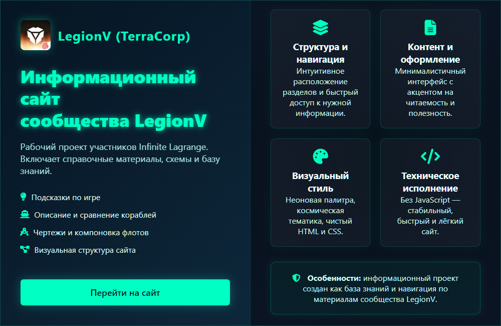
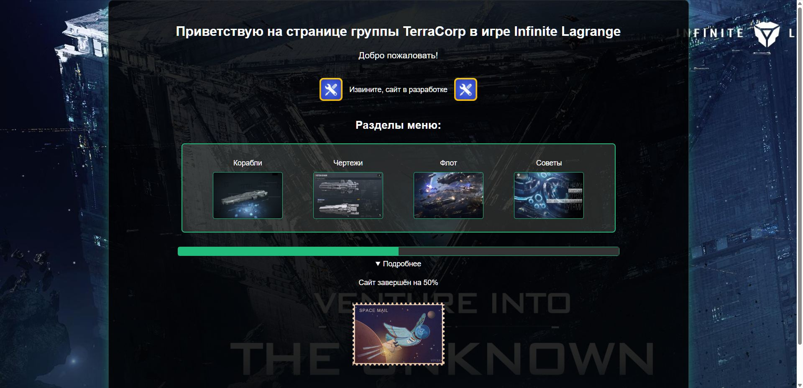
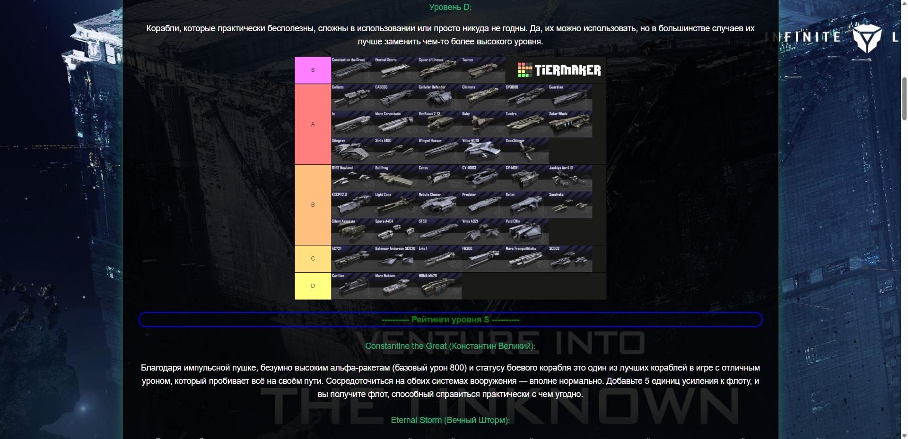
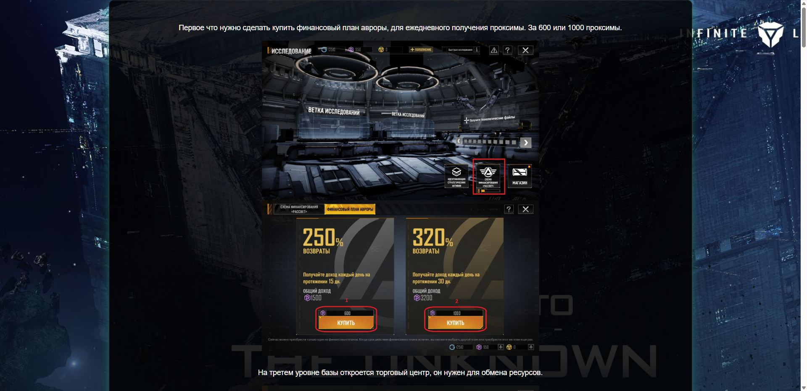

# Infinite Lagrange Guide

Информационный сайт по игре *Infinite Lagrange*.  
Проект создан для демонстрации адаптивной вёрстки, интерфейса в тематике sci-fi и организации игрового контента.

🔗 **Онлайн демо:** [Посмотреть на GitHub Pages](https://hoadf.github.io/LegionV/)  
💾 **Исходный код:** [Репозиторий на GitHub](https://github.com/hoadf/LegionV)

---

## 🖼️ Превью

---

## 📸 Скриншоты

| Главная страница | Корабли | Советы |
|------------------|------|---------------------|
|  |  |  |

---

## 💡 О проекте

Это сайт игрового сообщества, посвящённый вселенной *Infinite Lagrange*, и предназначен для размещения справочной информации и советов по игре.

### Основные разделы:
- 🚀 **Корабли** — база данных с изображениями и характеристиками  
- 🧩 **Чертежи** — коллекция доступных модификаций  
- ⚙️ **Флот** — примеры сборок и компоновок кораблей  
- 💬 **Советы** — рекомендации по прокачке и стратегиям  

Все разделы сайта заполнены и доступны.

---

## 🧩 Технологии

- **HTML5** — семантическая структура  
- **CSS3 (Flexbox / Grid)** — адаптивный дизайн и визуальные эффекты    

---

## 🖥️ Особенности

- Космическая атмосфера и футуристичный интерфейс  
- Светящиеся границы и неоновые акценты  
- Плавные анимации и динамическое меню  
- Совместимость с мобильными устройствами  
- Поддержка будущего расширения (новые страницы и база данных)

---

## 📤 Хостинг

Изначально сайт был размещён на **Neocities**,  
затем перенесён на **GitHub Pages** для открытого доступа и демонстрации.

---

## 📄 Лицензия

Проект распространяется под лицензией [MIT](LICENSE).  
Разрешено использование кода в **учебных и демонстрационных целях** с указанием автора.

---

✉️ **Автор проекта:** *HOADF*  
💬 **Направление:** веб-разработка, геймдизайн.  
📨 **Телеграм-канал автора:** [t.me/hoadf_bots](https://t.me/hoadf_bots)
